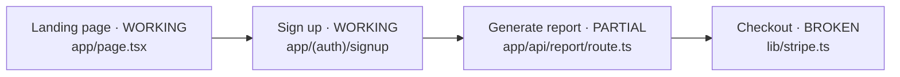

# Phase 0 — Recon

Collect facts first, then draw the architecture. Nothing in the repo is edited in this phase; the only files you write are `.revive/state.md` and `.revive/architecture.md`.

## 1. Collect facts

A fact is something you can point to: a file path, a commit hash, the output of a command. Anything else is a guess and stays out of the list. Guesses are useful later as interview questions, so keep them in your head, not in the state file.

### When and how it stopped

```bash
git status --short --branch
git log --all -1 --format='%ad  %h  %s' --date=short
git log --all -15 --format='%ad  %h  %d  %s' --date=short
git log --all --format='%ad' --date=format:'%Y-%m' | sort | uniq -c
git for-each-ref --sort=-committerdate --format='%(committerdate:short)  %(refname:short)  %(subject)' refs/heads refs/remotes
```

Use `--all` because a stalled repo is often left checked out on a side branch, and the last real work may be on a branch other than the current one.

Record:

- the date and message of the last commit
- the month where commit frequency dropped
- what the last few commits were working on (this is usually where the project stopped)
- which branch has the most recent work, branches that were never merged, and uncommitted work

If the folder is not a git repository, use file modification dates instead and record that there is no history.

### What exists and what is half-built

- `TODO`, `FIXME`, `HACK` and commented-out blocks, with file paths
- features that have a UI but no backend, or the reverse
- README: present, and does it describe the current state
- landing page: present or not
- deploy config: `vercel.json`, `netlify.toml`, `wrangler.toml`, `fly.toml`, `railway.json`, `Dockerfile`, CI workflows
- payments: a payment SDK in the dependencies, checkout or webhook code, price definitions
- auth: an auth library or provider, protected routes
- a live deployment: a URL in the README or config that still responds

### Does it run

Find the install, build and run commands from the README or the package manifest and try them once.

- If it works, record the commands that worked.
- If it fails, record the exact command and the first error message as a fact. Do not fix it now. Build recovery is the first task of the execution loop, after the verdict has said the project is worth fixing.
- If running it needs secrets you do not have, record which variables are missing. Do not ask the user for secret values in chat; ask them to put the values in their local env file.

### Material outside the repo

Read notes, planning documents or other sources only if the user listed them under `sources` in `state.md`. On the first run there is no `state.md` yet, so ask once: "Is there anything outside this repo I should read, such as notes or a planning document?"

- If a listed source needs a connector that is not connected, say so and continue with the repo alone.
- Mark every fact that came from outside the repo with its source.

### Write the facts

Create `.revive/state.md` from the template in `state-files.md` and fill in the confirmed facts, each with its evidence.

## 2. Draw the architecture

Write `.revive/architecture.md` with Mermaid diagrams. Mermaid is text, so you can read and edit it again in later sessions, and it renders as a picture on GitHub.

### Three diagrams

1. **System overview.** Screens, server, data stores and external services (auth, payments, hosting, AI APIs), and the connections between them.
2. **Code structure.** Dependencies between directories or modules, and the entry points.
3. **Core flow.** The path a customer takes: visit → sign up → core feature → payment. Mark the point where it breaks. Most stalled projects have no working path to payment, and this diagram shows exactly where the gap is.

### Rules

- Draw only what you confirmed in the code. Every node names the file or directory that proves it.
- Every node carries one status: `WORKING`, `PARTIAL`, `BROKEN` or `UNUSED`. Put the status in the label as text, because colours do not render everywhere.
- Split a diagram once it passes 20 nodes. A diagram nobody can read does neither of its jobs.
- If the repo is large, hand parts of the reading to read-only exploration subagents and assemble the result yourself. This is reading, not implementation, so it does not need the execution layer.

### Example

````markdown
## Core flow



| Node | Files | Status | Evidence |
|---|---|---|---|
| Checkout | `lib/stripe.ts`, `app/api/webhook/route.ts` | BROKEN | Webhook handler throws on missing signature secret; branch `payments` unmerged since 2026-03-12 |
````

### Improvement candidates

From the diagrams, list what looks wasteful:

- the same thing implemented twice
- code and dependencies nothing uses
- circular dependencies
- one file carrying too many responsibilities
- external calls that are not needed

For each candidate write the file paths and the evidence.

**Scope limit.** Only candidates that the first payment depends on go into milestones. Record the rest and leave them alone. The diagram is there to find problems, not to start a refactor.

### Where the diagrams get used

- Phase 1: to ground interview questions in what is actually there
- Phase 2: to name the code worth keeping
- Phase 3: to cut scope down to what the payment path needs
- Phase 4: as the starting point for debugging, and updated whenever structure changes

## Gate

`.revive/state.md` holds the confirmed facts with evidence, and `.revive/architecture.md` exists with the three diagrams, the node table and the candidate list. Then move to Phase 1.
